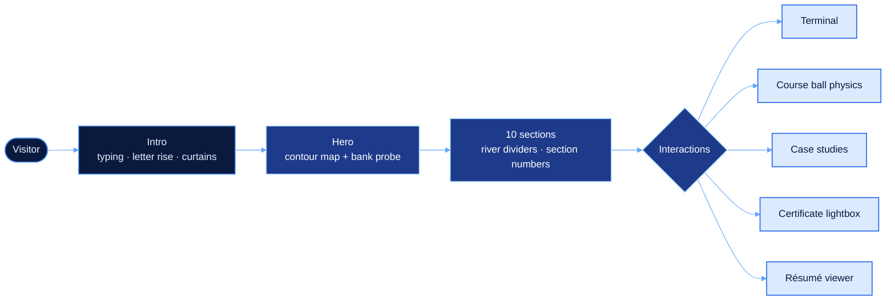
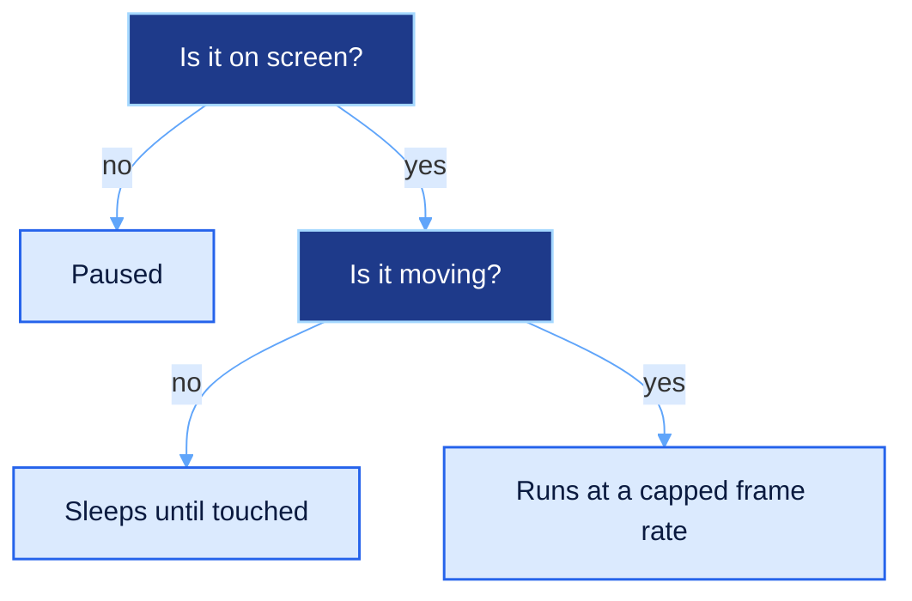

<div align="center">


<a href="https://sabikswanan.github.io"></a>

<br/>

<a href="https://sabikswanan.github.io"></a>

<br/><br/>


<br/><br/>

**[Overview](#overview)** &nbsp;|&nbsp;
**[Tour](#tour)** &nbsp;|&nbsp;
**[How It Works](#how-it-works)** &nbsp;|&nbsp;
**[Performance](#performance)** &nbsp;|&nbsp;
**[Terminal](#terminal)** &nbsp;|&nbsp;
**[Structure](#structure)** &nbsp;|&nbsp;
**[Run It](#run-it)**

</div>

<br/>

<a name="overview"></a>

## 🛰️ Overview

This is the source of my personal portfolio, live at **[sabikswanan.github.io](https://sabikswanan.github.io)**.

My undergraduate thesis predicts **riverbank erosion on the Jamuna** from decades of satellite imagery, so the
site is designed like a **remote-sensing ground station**: the hero is a live contour map with a meandering
river and a probe that reads out erosion risk, sections are joined by river-shaped dividers, and the intro
"acquires" the page before it opens.

Everything is **hand-written HTML, CSS and JavaScript** in a single `index.html`. No React, no build step, no
animation library, no physics engine. It is fast on phones, works in **dark and light** mode, and respects
**reduced-motion** settings.

<br/>

<a name="tour"></a>

## 🧭 A Tour of the Site

| # | Section | What you can do there |
|:-:|---|---|
| 00 | **Intro** | *"Hi, this is"* types out, the name rises letter by letter, a river draws itself, then two curtains lift |
| — | **Hero** | Move over the animated **contour map** to drive the **bank probe** (latitude, distance to channel, erosion risk) |
| 01 | **About** | Photo card with a rotating light border and quick facts |
| 02 | **What I do** | Three kinds of problems I like to work on |
| 03 | **Research** | Step through my thesis pipeline, from Landsat tiles to the LLM report layer |
| 04 | **Work** | Four project cards with live mini-visualisations, filters and full case studies |
| 05 | **Terminal** | A working shell. Type `help` |
| 06 | **Toolbox** | Every tool I have shipped with, plus a scrolling tech strip |
| 07 | **Coursework** | **27 course balls** with real physics. Grab, throw, shake, tap one to read about it |
| 08 | **Journey** | Timeline from SSC to the thesis |
| 09 | **Proof** | Certificate gallery with a lightbox, DofE first |
| 10 | **Contact** | Copy-to-clipboard email and a message form |

<br/>

<a name="how-it-works"></a>

## ⚙️ How It Works



| Piece | How it is built |
|---|---|
| **Contour map** | Value noise → height grid → **marching squares** on a `<canvas>`, with a river carved through the terrain. Contours are cached on an offscreen canvas and redrawn every few frames |
| **Bank probe** | Reads the river's curvature and the cursor's distance from the channel to estimate an illustrative erosion risk |
| **Course balls** | A small custom physics engine: gravity, wall bounce, ball-to-ball impulses, drag-and-throw with pointer velocity |
| **Section transitions** | An SVG river path draws itself with scroll progress while a glowing probe rides along it |
| **Smooth scroll** | Inertia scrolling for mouse and trackpad, eased glides for every in-page link, native momentum kept on phones |
| **Reveals** | `IntersectionObserver` triggers fades, word-by-word titles and decoding labels only when a section enters view |
| **Themes** | CSS custom properties with a dark default, a light override and a manual toggle |

<br/>

<a name="performance"></a>

## ⚡ Performance

Smooth on a mid-range phone was a hard requirement, so every moving part only runs when it is needed.



- The hero map pauses off screen and in background tabs, caches its contour layer and runs at a lower resolution and frame rate on phones
- Ball physics, the custom cursor and the hero glow **go to sleep** once they stop moving
- The tech strip pauses when it scrolls out of view
- Expensive effects (backdrop blur, `shadowBlur`, animated `filter`) were replaced with cheaper equivalents
- Certificate thumbnails are embedded, full-size images are preloaded after the page settles
- In a 4× CPU-throttled test, a performance pass cut the page's scripting time to about **one third**

<br/>

<a name="terminal"></a>

## 💻 Terminal Commands

The site has a small shell in the **Terminal** section. Try these:

| Command | Output |
|---|---|
| `help` | List every command |
| `whoami` | Who I am and what I focus on |
| `projects` | One-line summary of each project |
| `thesis` | My research in one paragraph |
| `skills` | Tools I use, by area |
| `contact` · `social` | Email, LinkedIn and GitHub |
| `resume` | Opens the résumé viewer |
| `ls` · `date` | Exactly what you would expect |
| `sudo hire sabik` | 🤫 |
| `clear` | Clear the screen |

<br/>

<a name="structure"></a>

## 📁 Structure

```text
sabikswanan.github.io/
├── index.html              ← the whole site: markup, styles and scripts
├── profile.jpg             ← About photo
├── Sabik_Swanan_CV.pdf     ← downloadable résumé
├── cv-page-1.jpg           ← résumé preview, page 1
├── cv-page-2.jpg           ← résumé preview, page 2
└── certs/
    ├── *.jpg               ← full-size certificates for the lightbox
    └── thumb/*.jpg         ← small certificate thumbnails
```

<br/>

<a name="run-it"></a>

## 🚀 Run It

**Locally:** download or clone the repo and open `index.html` in any modern browser. No install, no build.

```bash
git clone https://github.com/sabikswanan/sabikswanan.github.io.git
cd sabikswanan.github.io
# open index.html, or serve the folder:
python -m http.server 8000
```

**Deploy:** this repo is served by **GitHub Pages** from the `main` branch root. Any commit to `main` goes live
in a minute or two.

> [!TIP]
> To update the résumé, replace `Sabik_Swanan_CV.pdf`, `cv-page-1.jpg` and `cv-page-2.jpg` with new files
> of the same names and commit.

<br/>

<div align="center">

**Sabik Swanan**<br/>
B.Sc. in Computer Science · BRAC University · Dhaka

<br/>

<a href="https://sabikswanan.github.io"></a>
<a href="https://github.com/sabikswanan"></a>
<a href="https://www.linkedin.com/in/sabikswanan"></a>
<a href="https://mail.google.com/mail/?view=cm&fs=1&to=sabikswanan@gmail.com"></a>

<br/><br/>

<sub>⭐ Star this repo if you liked the site</sub>


</div>
